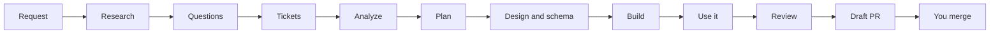

<div align="center">

# 🏭 AI Software Factory

**Your coding agent, run like a software team. Idea in, reviewed draft PR out.**

Research, tickets, analysis, plan, build, QA, review and PR, in that order, every time.


</div>

Coding agents jump straight to code. They skip the research, forget the ticket, test nothing and tell you it works. More instructions do not fix that, because an agent can ignore any instruction.

The factory **enforces** the process. Hooks block source edits until the ticket, analysis and plan are recorded. Every run ends in a draft pull request with before/after proof and a list of what is still unverified. You merge.

## ⚡ Install in one step

Paste this to your coding agent:

```text
Install the AI Software Factory for this agent from https://github.com/seifsg/ai-software-factory.
Clone it, follow docs/install.md and run its installer for this agent.
```

Claude Code, from a terminal:

```bash
claude plugin marketplace add https://github.com/seifsg/ai-software-factory.git
claude plugin install safe-engine@ai-software-factory
```

Then ask your agent:

```text
safe-engine Build [app or feature] in [absolute project directory]. Success means [observable outcome].
```

Manual install, flags and every agent's syntax: [install](docs/install.md) · [hosts](docs/hosts.md).

## 🏆 Why it works

- 🔒 **Enforced, not suggested.** A gate and host hooks deny code edits until earlier steps pass, and push back when the agent tries to stop mid-run.
- 📣 **Progress you can see.** A mini dashboard from the gate, once per change: the ticket in progress with its bar, what just finished, what is being built now and what you will be able to do once it is done, what comes next, and any question waiting on you. When nothing changed, a hook spends under 0.1 ms on it.
- 🔎 **Research before code.** New products and big features start with competitors, a feature matrix, opportunities and stack options.
- ❓ **Questions that fit the size.** A POC builds exactly what you asked and asks only what the request leaves open. An MVP researches launch gaps, suggests features you did not think of and ships analytics and in-app feedback. Answers are recorded and binding.
- 🎫 **A living backlog.** Every run reads it, cleans up issues after merged or closed PRs, and opens an epic with outcome sub-issues; follow-ups update existing tickets instead. Each ticket carries a definition of done and a checklist; an item is ticked only after it works, and a ticket is finished only when every item is. Tickets move through To do, In progress, Dev done and Ready for QA; your merge makes them Done. Items outside the task stay untouched.
- 🎚️ **Right-sized.** Fast by default, Lucky for quick tries, Safe for work that must not break. In Fast and Lucky, small tasks and follow-ups take a light lane: no analysis step, a short plan, the same checks.
- 🧪 **Proof, not promises.** Every requested item traces to a criterion, a checklist item and proof. Every checklist item is used before its tick, then a done-run with real controls and logs; Safe adds manual QA, tests and an independent reviewer.
- 🎨 **A product bar.** Accessible, responsive UI, clear copy, public-page SEO and a designed schema. Fast UI runs plan their map, hierarchy and labels, and every UI run gets a fresh agent's check against ten UX rules before the gate lets it finish. Non-production builds show their environment and label sample data.
- 🧑‍⚖️ **Humans stay in charge.** Draft PRs only. It never merges, releases or deploys.
- 🌍 **Any agent, any OS, any codebase.** Games, web, mobile and desktop apps, services, tools and libraries.

## 🎬 What a run looks like

Illustrative example:

```text
safe-engine Build a habit tracker in /home/me/habits. Success means a signed-in user adds a habit and sees a streak.
```

1. Researches three competitors and writes a feature matrix with opportunities.
2. Asks you about size, features, approach and stack: one round for a POC, more for an MVP.
3. Reads the backlog, then opens an epic and outcome sub-issues in To do, each with a definition of done.
4. Analyzes requirements and consumers, then writes a plan whose todos become each ticket's checklist.
5. Writes the design brief and the schema decision.
6. Builds every checklist item through a check-change-check loop and ticks it once it works.
7. Runs the app through every requested journey and its most likely failure.
8. Opens a draft PR with before/after proof and what is unverified. Tickets wait in Ready for QA until you merge.



## ⚖️ Instructions alone vs the factory

| | Instructions alone | AI Software Factory |
|---|---|---|
| Skipping steps | The agent can skip any step | Code edits are denied until ticket, analysis and plan pass the gate |
| Stopping early | The agent can stop and say "done" | Stopping mid-run is blocked once, with the next step named; waiting on background agents costs no extra turn where the host reports them |
| Proof | The agent's word | Done-run results and logs; Safe adds QA, tests and independent review |
| Review | The same agent grades itself | Safe: a different agent reviews from raw evidence |
| Process size | One size for every task | Fast, Lucky or Safe |
| Output | Changes in your working tree | Ticket plus draft PR with before/after |

## 🎚️ Modes

| | 🏃 Fast (default) | 🍀 Lucky | 🛡️ Safe |
|---|---|---|---|
| Best for | Everyday features and products | Quick experiments | Work that must not break |
| Research and questions | New products and big features | Skipped, sensible defaults | Always |
| Planning | Full analysis and plan | One short pass | Full, plus a stop to review the file list |
| Enforcement | Gate and hooks | Gate and hooks | Python controller |
| Checks | Each checklist item, then a done-run | Each checklist item, then a done-run | Each item, manual QA, tests, verify, independent review |

Add `lucky` or `safe` after the skill name. Resume any run with `safe-engine Resume [absolute project directory]`.

## 🧰 Skills

| Skill | Job |
|---|---|
| `safe-engine` | Runs delivery in Fast, Lucky or Safe mode; holds the work rules and product bar |
| `research-market` | Competitors, feature matrix, opportunities, stack and architecture options |
| `analyze-start` | Understands the code and every consumer before changing it |
| `get-ready-to-code` | Files, critique, phases, todos and the whole plan |
| `ux-quality` | Ten UX rules (map, navigation, hierarchy, disclosure, labels, cost, states, access, look, speed) judged by fresh eyes; copy; public-page SEO |
| `database-schema` | Access patterns, three designs, chosen schema, indexes, migrations |
| `deep-review` | Bug hunt plus change-guard, compliance, security, performance and journey lenses |
| `ticketing` | Backlog upkeep: epic and outcome sub-issues with before/after, a definition of done, a checklist, status, priority and an activity timeline |
| `how-to-make-a-pr` | Draft PR with ticket link, before/after proof and what is unverified |
| `improve-factory` | Repairs or improves the factory itself without disturbing active runs |

Each skill lives in `.agents/skills/<name>/` and stands alone.

## 🤖 Supported agents

- **First-class** (installer, gate hooks, Safe reviewer): Claude Code, Codex, Cursor.
- **Supported:** GitHub Copilot, Gemini CLI, OpenCode, and any agent that can read a `SKILL.md` file.

Details per agent: [hosts](docs/hosts.md).

## ❓ FAQ

**Does it push to main, merge or deploy?**
No. It opens draft PRs. Humans mark them ready, merge and release.

**Does the gate judge quality?**
No. It proves each step was recorded, not that it was good. Quality comes from the methods and the done-run; Safe adds tests and an independent review.

**Does it work on an existing codebase?**
Yes. `analyze-start` reads the code and every consumer before anything changes.

**Which tracker?**
GitHub Issues are checked online. Other trackers are recorded and marked unverified.

**What do I need?**
Git and Python 3.9 or newer. The launchers find or install them from official sources.

**A run stopped or my session ended. Now what?**
`safe-engine Resume [absolute project directory]` reads the ticket and the work record, then continues the first unfinished step.

## 🗂️ Layout

```text
.agents/skills/        the skills (canonical methods)
skills/                portable launchers, gate scripts and the Claude Code plugin root
safe_engine/           Safe mode controller (python -m safe_engine)
docs/                  install and hosts
tests/                 controller, gate, installer and skill hygiene tests
```
