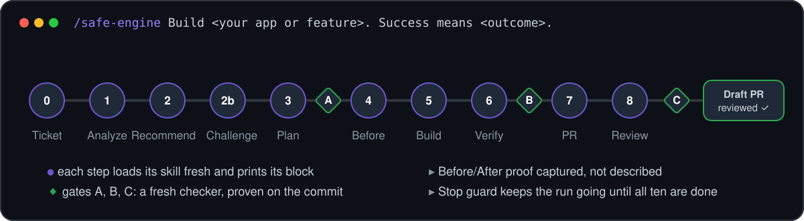
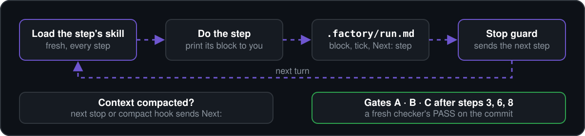

<div align="center">

# 🏭 AI Software Factory

### Your coding agent, run like a software team.
**One request in. Ten checked steps. A reviewed draft PR out.**

<a href="https://github.com/seifsg/ai-software-factory/releases/latest"></a> <a href="LICENSE"></a> 

**[Quick start](#-quick-start) · [A run](#-a-run) · [How it stays on track](#%EF%B8%8F-how-it-stays-on-track) · [Update](#-update) · [Troubleshooting](#-troubleshooting)**



</div>

Coding agents jump straight to code, forget the method as context grows, and tell you it works. The factory is a set of skills that gives your agent a team's process, plus one small hook script that keeps the run going until every step is done and checked. No runtime, no Python, nothing on every tool call.

<table>
<tr>
<td width="33%" valign="top">

### 🧭 A process, not a prompt
Ten steps in order, every time. Each step loads its skill fresh, prints its block to you and writes it to `.factory/run.md`.

</td>
<td width="33%" valign="top">

### 🔒 Gates it cannot skip
After plan, verify and review, a fresh checker compares the outputs with each skill's contract. The run cannot close until all three pass on the commit, or you waive one.

</td>
<td width="33%" valign="top">

### 📸 Proof, not claims
Before is captured before the first edit, After during verify, and both land in the draft PR. A fresh agent that did not build it reviews the PR.

</td>
</tr>
</table>

## ⚡ Quick start

**1. Install**: Claude Code and Cursor in a session, Codex in a terminal ([all options](docs/install.md)):

| | **Claude Code** | **Codex** (full delivery pending) | **Cursor** (not yet run live) |
|---|---|---|---|
| Add marketplace | `/plugin marketplace add https://github.com/seifsg/ai-software-factory.git` | `codex plugin marketplace add https://github.com/seifsg/ai-software-factory.git --sparse .claude-plugin --sparse .agents` | `/plugin marketplace add https://github.com/seifsg/ai-software-factory.git` |
| Install | `/plugin install safe-factory@ai-software-factory` | `codex plugin add safe-factory@ai-software-factory`, then trust its hooks in `/hooks` | `/plugin`, install `safe-factory` |
| Run | `/safe-factory` | `$safe-factory` | `/safe-factory` |
| One skill alone | `/safe-factory:analyze-start` | type `$`, pick `analyze-start` | `/analyze-start` |
| Hooks | built in | built in; trust again in `/hooks` after each update | built in, not yet run live; with the Claude Code plugin too, install only one ([Cursor](docs/install.md#cursor)) |

Start a new session; your agent should list `safe-factory`. Other agents: copy the skills ([other agents](docs/install.md#other-agents)). You need Git, the GitHub CLI signed in (`gh auth login`) for tickets and draft PRs, and on Windows Git Bash (part of Git for Windows) for the hooks. To try unreleased `main`, run `claude --plugin-dir <clone>/.agents`.

The Codex Windows plugin locates Git Bash beside `git.exe` on `PATH`; its native launcher preserves the hook input and output. A bounded native test verified ticket, analysis, recommendation and challenge as separate prompt/response rounds, followed by the requested stop. Full delivery remains unverified. After updating, review the changed hooks in `/hooks` before relying on automatic turns.

**2. Ask** (`/safe-factory` in Claude Code and Cursor, `$safe-factory` in Codex):

```text
safe-factory Build [app or feature] in [absolute project directory, or leave it out for a new project]. Success means [observable outcome].
```

**3. Watch, answer, merge.** A ticket link comes first, then one block per step. Answer questions when asked. You end with a draft PR that carries Before/After proof and a reviewer's verdict: review it and merge it.

```text
safe-factory Resume [absolute project directory].
```

## 🎬 A run

| Step | Skill | You see |
|---|---|---|
| 0 Ticket | `ticketing` | ticket link, criteria, checklist |
| 1 Analyze | `analyze-start` | purpose, ASCII flow, every consumer, claim vs code, unknowns |
| 2 Recommend | `recommend` | three options in one table, one pick; new UI also gets three looks, one pick |
| 2b Challenge | `recommend` | the pick rechecked against "do better": kept or changed, and why |
| 3 Plan | `get-ready-to-code` | files, critique, phases, todos, proof list, test map, then **Gate A** |
| 4 Before | `how-to-make-a-pr` | Before screenshots and outputs, saved before the first edit |
| 5 Build | `get-ready-to-code` | one line per todo, through the 0–4 loop |
| 6 Verify | `deep-review` | findings, UI pass, one full suite run, After captures, then **Gate B** |
| 7 PR | `how-to-make-a-pr` | draft PR with Before/After pairs |
| 8 Review | `how-to-review-a-pr` | a fresh agent's verdict, then **Gate C** |

Products and big features add `research-market` and kickoff questions at step 0; persistence adds `database-schema`. **Fast** (default) runs straight through; **Safe** also stops for your OK on the plan.

## 🛡️ How it stays on track



Long runs lose skill text when the host compacts context. The factory works around it instead of hoping:

- The run cannot close without step 8, three gates and a review; Gate C and the review on the pushed HEAD (no remote: HEAD). Claude Code: a small model judges each gate line from the conversation, and an agent could still fool it; the check tests that the line exists, and Gate C and the review on the pushed HEAD. Codex, Cursor and night runs: the host's record of that checker or reviewer on that commit proves it.
- Loops never stall (counted on command-guard hosts; on plain Claude Code the agent keeps the count): after 3 failed rounds with no open `CRITICAL:` line the gate or review passes by cap (`Gate X: PASS (cap, 3 rounds, no CRITICAL)`) and leftovers go to follow-ups; rounds 4-5 only while a `CRITICAL:` is open. After round 5, or 6 turns without progress, the guard halts the run with one packet for you. `sh run-guard.sh clear <run folder>` resumes it.
- Waiting on you is allowed (`Waiting: owner:`); waiting on background jobs needs a deadline (`(max <n> min)`), past which the guard wakes the run.
- Codex, Cursor and night runs: after two compactions the run moves to a fresh session that reads only the run file and the ticket.
- Claude Code: once a step loads `stop-check`, a small model checks each turn end and continues only after a new step block or todo line, so a looping agent stops within a few turns (very likely, not certain; [token limit](docs/hosts.md)); the check script reads the run file and Git, never the conversation. Codex, Cursor and night runs: a command guard reads the run file and the run's subagent files, about 0.4 s per turn end on Windows. Nothing per tool call.

### 🌙 Overnight runs

`tools/night/night.sh` refuses to start unless the run can finish unattended (guard wired, deny rules, own branch, `pre-push` hook, push dry run, tracker sign-in), then starts a session that denies instead of prompting. Owner questions get recorded defaults, owner-only items are parked, and nothing leaves the machine but the run's branch, draft PR and tickets. A watchdog from the OS scheduler resumes a stalled run, waits out usage limits, starts relays and tells you once how it ended. Setup: [install](docs/install.md#overnight-runs).

Details: [run file](.agents/skills/safe-factory/references/run-file.md), [checker](.agents/skills/safe-factory/references/checker.md), [night mode](.agents/skills/safe-factory/references/night.md), [hosts](docs/hosts.md).

## 🔄 Update

- A run's first step (Claude Code) or each session start (Codex, Cursor) checks for a newer release (cached, about 0.2 s on Windows) and says so before a run ([update check](docs/install.md#update-check)). It also lists leftovers of old versions; `doctor.sh --fix` moves them to a backup ([clean up](docs/install.md#clean-up-and-uninstall)).
- **Claude Code:** `claude plugin update safe-factory@ai-software-factory`. Auto-update is off for third-party marketplaces: turn it on in `/plugin`, Marketplaces, `ai-software-factory`, Enable auto-update.
- **Codex:** `codex plugin marketplace upgrade ai-software-factory`, then trust the hooks again in `/hooks`. Copied skills: `git -C <clone> pull`, copy again.
- **Cursor:** Marketplace installs update by themselves; team imports do once an admin enables Auto Refresh. A GitHub install has no proven update path: Cursor staff advise against uninstalling and reinstalling, and report such installs stay on their first commit. Not run live.
- What changed: [CHANGELOG.md](CHANGELOG.md). What to do: [UPGRADING.md](UPGRADING.md).

## 🧹 Uninstall

- **Claude Code:** `/plugin uninstall safe-factory@ai-software-factory`, or `claude plugin marketplace remove ai-software-factory` to drop the marketplace too.
- **Codex:** `codex plugin remove safe-factory@ai-software-factory`. Copied skills: delete the skill folders and the two hook entries from `~/.codex/hooks.json`.
- **Cursor:** `/plugin`, uninstall `safe-factory`.

Projects keep `.factory/` folders until you delete them.

## 🩺 Troubleshooting

| Symptom | Fix |
|---|---|
| `safe-factory` not listed | Start a new session; check `/plugin` (Claude Code) or the copied folder under `~/.agents/skills` (Codex) |
| Agent stops mid-run | Check hooks are installed and trusted (Codex: `/hooks`); read `.factory/run.md`; say "resume" |
| Run will not stop | `Waiting:` must name what you wait for; to abandon, set `Status: stopped (<reason>)` |
| Run halted | Read the packet under the current step in `.factory/run.md`, decide, then run the guard with `clear` |
| Gate line "has not passed" | Paste the checker's line with its id and commit; Gate C needs the pushed HEAD, unless no remote |
| Hook errors on Windows | Install Git for Windows; hooks need its `sh` |

## 🧰 Skills

| Skill | What it does |
|---|---|
| `safe-factory` | the ten-step coordinator, run file and gates |
| `ticketing` | backlog, epics, tickets, checklists and statuses |
| `stop-check` | arms the Stop check before each step |
| `analyze-start` | analysis before any code |
| `recommend` | three solutions, one pick, and the step 2b challenge |
| `get-ready-to-code` | the plan and the 0–4 build loop |
| `deep-review` | verify: bug hunt and review lenses |
| `how-to-make-a-pr` | Before/After proof and the draft PR |
| `how-to-review-a-pr` | the fresh-agent PR review |
| `database-schema`, `research-market` | specialists the steps call when needed |
| `improve-factory` | repairs the factory itself: `improve-factory The factory did [observed]; expected [result].` |

## 🛠️ Work on the factory

Rules: [AGENTS.md](AGENTS.md). Changes go through `improve-factory`; checks: `sh scripts/check.sh`. Releases: [docs/releasing.md](docs/releasing.md) (`sh scripts/release.sh`). Report problems as [issues](https://github.com/seifsg/ai-software-factory/issues).

```text
.agents/skills/                  the skills (canonical methods)
.agents/agents/                  delegate roles for Claude Code (runner, analyst, maker, builder, reviewer, checker)
.agents/skills/stop-check/       Claude Code's prompt Stop hook
.agents/skills/safe-factory/     the coordinator; scripts/ holds the guard, update check, doctor
.agents/hooks/portable.json      Stop guard, compact hook and update check (Codex, Cursor)
tools/night/                     overnight runs, from a clone: night.sh, watchdog.sh, deny rules, pre-push
.agents/.claude-plugin/          plugin manifests (also .codex-plugin/, .cursor-plugin/); the plugin root is .agents/
.claude-plugin/marketplace.json  the marketplace (Claude Code, Codex), pinned to the release tag
.cursor-plugin/marketplace.json  the Cursor marketplace
docs/                            install, hosts, releasing; docs/assets/ holds the README images
CHANGELOG.md, UPGRADING.md       what changed per release, and what to do
PRIVACY.md, SECURITY.md          what leaves your machine; how to report a vulnerability
```

## 📄 License

[MIT](LICENSE).
