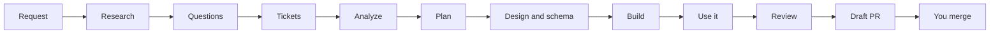

<div align="center">

# 🏭 AI Software Factory

**Your coding agent, run like a software team. Idea in, proven draft PR out.**

Research, tickets, analysis, plan, build, QA, review and PR, in that order, every time.


**[Quick start](#-quick-start) · [Use it](#-use-it) · [Update](#-update) · [Troubleshooting](#-troubleshooting) · [FAQ](#-faq)**

</div>

Coding agents jump straight to code. They skip the research, forget the ticket, test nothing and tell you it works. More instructions do not fix that, because an agent can ignore any instruction.

The factory **enforces** the process. Hooks block source edits until the ticket, analysis and plan are recorded. Every run ends in a draft pull request with before/after proof and a list of what is still unverified. You merge.

## ⚡ Quick start

**You need:**

- A coding agent. Claude Code, Codex and Cursor get the installer and gate hooks; any agent that reads a `SKILL.md` file works ([hosts](docs/hosts.md)).
- Git and Python 3.9 or newer (`python`, `python3` or `py -3` on Windows). Missing ones: an agent given the install prompt below installs them from official sources.
- Read access to this repository and the GitHub CLI signed in (`gh auth login`). Git fetches the factory over HTTPS with those credentials, and runs use `gh` for GitHub tickets and draft PRs.
- Windows with Claude Code: Git Bash (part of Git for Windows), because its hooks run in a POSIX `sh`.

**Then:**

1. **Install.** Paste this to your coding agent, or use the [install options](#-install-options):

   ```text
   Install the AI Software Factory for this agent from https://github.com/seifsg/ai-software-factory.
   Clone it, follow docs/install.md and run its installer for this agent.
   ```

2. **Check it.** Start a new session. Your agent should list or autocomplete `safe-engine`. Not there: [troubleshooting](#-troubleshooting).
3. **Build.** Type this in your agent's chat, not in a terminal, as `/safe-engine ...` in Claude Code, `$safe-engine ...` in Codex, or "use safe-engine to build ..." in Cursor:

   ```text
   safe-engine Build [app or feature] in [absolute project directory]. Success means [observable outcome].
   ```

4. **Answer, watch, merge.** Answer its questions, follow the progress card, then review the draft PR and merge it.

Already have code? Point it at that directory. Feature runs analyze the existing code and every consumer before planning (`analyze-start`).

## 🎬 What a run looks like

Illustrative example:

```text
safe-engine Build a habit tracker in /home/me/habits. Success means a signed-in user adds a habit and sees a streak.
```

1. Researches three competitors and writes a feature matrix with opportunities.
2. Asks you about size, features, approach and stack: one round for a POC, more for an MVP.
3. Reads the backlog, then opens an epic and outcome sub-issues in To do, each with a definition of done.
4. Analyzes requirements and consumers, then writes a plan whose todos become each ticket's checklist. Before each build wave, a fresh agent writes the hidden checks for the criteria that wave builds.
5. Writes the design brief and the schema decision.
6. Builds every checklist item through a check-change-check loop and ticks it once it works.
7. Runs the app through every requested journey and its most likely failure; the hidden checks decide each criterion.
8. Opens a draft PR with before and after for every outcome and what is unverified. Tickets wait in Ready for QA until you merge.

While it works, the gate shows a card after every step and finished todo (illustrative):

```text
🏭 portal-poc · 🔨 build · step 6/8 · ⏱️ 42m total, 5m in step
🎫 #12 Download & SEO   ▰▰▱ 2/3 · run 5/9
✅ SEO: title and description on every page
🔨 NOW  Download button
     → click it and the PDF saves
⏭️ NEXT Contact form
```



## 🏆 Why it works

- 🔒 **Enforced, not suggested.** A gate and host hooks deny code edits until earlier steps pass, and push back when the agent tries to stop mid-run. The gate keeps its state outside your project, so nothing written there can switch it off.
- 🛑 **Destructive commands refused.** During a run, hooks deny recursive deletes outside the project, force pushes, `git clean -x`, `DROP` or `TRUNCATE`, database wipes and production migrations. You run those yourself or pick another approach.
- 📣 **Progress you can see.** The card above, once per change, plus any question waiting on you. When nothing changed, a hook spends under 0.1 ms on it.
- 🔎 **Research before code.** New products and big features start with competitors, a feature matrix, opportunities and stack options.
- ❓ **Questions that fit the size.** A POC builds exactly what you asked and asks only what the request leaves open. An MVP researches launch gaps, suggests features you did not think of and ships analytics and in-app feedback. Answers are recorded and binding.
- 🎫 **A living backlog.** Every run reads it, cleans up issues after merged or closed PRs, and opens an epic with outcome sub-issues; follow-ups update existing tickets instead. Each ticket has a definition of done and a checklist; an item is ticked only after it works. Tickets move through To do, In progress, Dev done and Ready for QA; your merge makes them Done.
- 🎚️ **Right-sized.** Fast by default, Lucky for quick tries, Safe for work that must not break. Small tasks and follow-ups take a light lane: no analysis step, a short plan, the same checks.
- 🧪 **Proof, not promises.** Every requested item traces to a criterion, a checklist item and proof. In product and feature runs, a fresh agent writes a check for every criterion before the build, from the tickets and plan alone; the builder never sees them, and any FAIL sends the work back. Then a done-run with real controls and logs, and a PR showing before and after for every outcome, which the gate reads before the run can finish. MVPs and production slices also record a secret scan, a dependency audit and static analysis. Safe adds manual QA, tests and an independent reviewer.
- 🩹 **Root causes, not patches.** A bug or edge case is fixed where it starts: impossible by design, or rejected loudly where data enters. No silent defaults. A big or risky refactor waits for your yes.
- 🎨 **A product bar.** Accessible, responsive UI, clear copy, public-page SEO and a designed schema. Every UI run gets a fresh agent's check against ten UX rules before the gate lets it finish. Non-production builds show their environment and label sample data.
- 🧑‍⚖️ **Humans stay in charge.** Draft PRs only. It never merges, releases or deploys.
- 🌍 **Any agent, any OS, any codebase.** Games, web, mobile and desktop apps, services, tools and libraries.

## ⚖️ Instructions alone vs the factory

| | Instructions alone | AI Software Factory |
|---|---|---|
| Skipping steps | The agent can skip any step | Code edits are denied until ticket, analysis and plan pass the gate |
| Stopping early | The agent can stop and say "done" | Stopping mid-run is blocked once, with the next step named; waiting on background agents costs no extra turn where the host reports them |
| Dangerous commands | The agent can run them | Deletes outside the project, force pushes and database wipes are denied during a run |
| Proof | The agent's word | Hidden checks the builder never saw, done-run results and logs; Safe adds QA, tests and independent review |
| Review | The same agent grades itself | Safe: a different agent reviews from raw evidence |
| Process size | One size for every task | Fast, Lucky or Safe |
| Output | Changes in your working tree | Ticket plus draft PR with before and after for every outcome |

## 🚀 Use it

Type requests in your agent's chat, in its syntax: `/safe-engine` in Claude Code, `$safe-engine` in Codex, "use safe-engine to ..." in Cursor. The examples below leave that prefix out.

**Pick a mode.** Add `lucky` or `safe` after the skill name; no mode means Fast.

| | 🏃 Fast (default) | 🍀 Lucky | 🛡️ Safe |
|---|---|---|---|
| Best for | Everyday features and products | Quick experiments | Work that must not break |
| Research and questions | New products and big features | Skipped, sensible defaults | Always |
| Planning | Full analysis and plan | One short pass | Full, plus a stop to review the file list |
| Enforcement | Gate and hooks | Gate and hooks | Python controller |
| Checks | Each checklist item, hidden checks, then a done-run | Each checklist item, hidden checks, then a done-run | Each item, manual QA, tests, verify, independent review |

```text
safe-engine Build [app or feature] in [absolute project directory]. Success means [observable outcome].
safe-engine lucky Fix [bug] in [absolute project directory].
safe-engine safe Add [feature] to [absolute project directory]. Success means [observable outcome].
safe-engine Resume [absolute project directory]
safe-engine Verify [absolute project directory]
safe-engine Promote [absolute project directory]
improve-factory The factory did [observed]; expected [result].
```

- **Resume** reads the ticket and the work record, then continues the first unfinished step.
- **Verify** adds manual QA and tests to a Fast or Lucky run. **Promote** moves it to Safe on the same epic.
- **improve-factory** repairs the factory itself when it skipped a step or misbehaved. Product bugs go back to `safe-engine`.
- **Your part:** answer its questions (the run waits, and your answers bind it), review the draft PR and merge. Before a Fast or Lucky PR it offers an optional Safe check: manual QA, tests and an independent review.

## 📦 Install options

The installer, from a clone. Replace `claude` with `codex`, `cursor` or `other`, and `python` with `python3` or `py -3` where needed:

```bash
git clone https://github.com/seifsg/ai-software-factory.git
python ai-software-factory/skills/safe-engine/scripts/fast_gate.py install --host claude
```

- `claude` enables the plugin (skills and gate hooks) with auto-update. Start a new session.
- `codex` and `cursor` copy the `safe-engine` and `improve-factory` skills into `~/.agents/skills` and write the gate hooks. Codex asks you to trust them once in `/hooks`.
- `other` copies those skills only; wire the hooks by hand ([hosts](docs/hosts.md#other-agents)).
- `--project <dir>` installs into one project instead of your user folders.

Claude Code without a clone. This route leaves auto-update off: turn it on in `/plugin` under Marketplaces, or [update by hand](#-update).

```bash
claude plugin marketplace add https://github.com/seifsg/ai-software-factory.git
claude plugin install safe-engine@ai-software-factory
```

Details: [install](docs/install.md) · [hosts](docs/hosts.md).

## 🔄 Update

| Installed with | How it updates |
|---|---|
| Claude Code, through the installer | On its own: during a session Claude Code fetches new versions; `/reload-plugins` or a new session loads them |
| Claude Code, right now (any route) | `claude plugin marketplace update ai-software-factory`, then `claude plugin update safe-engine@ai-software-factory`, then a new session |
| Codex, Cursor, other | `git pull` in your factory clone, then run the same `fast_gate.py install --host ...` again. It replaces only the factory's own files and hook entries |

**Projects stay pinned.** On first use a project pins the factory's main branch to one commit, and every later run and resume there reads its methods from that commit, offline. New projects get the newest methods; updating the install brings new launchers and hooks. To switch a project to newer methods, ask `improve-factory Switch [absolute project directory] to the newest factory.` It checks the run is compatible first.

## 🧹 Uninstall

- **Claude Code:** `claude plugin marketplace remove ai-software-factory` removes the marketplace from your settings and uninstalls its plugin. The installer kept your earlier settings as `~/.claude/settings.json.bak-before-safe-engine`.
- **Codex, Cursor, other:** delete `safe-engine` and `improve-factory` from `~/.agents/skills` (or `<dir>/.agents/skills`), then remove the hook entries naming `run-gate` or `fast_gate` from `hooks.json` in `~/.codex` or `~/.cursor` (or `<dir>/.codex`, `<dir>/.cursor`). Delete your factory clone too.
- **Data:** `~/.safe-engine/` holds the pinned factory copies and the gate's run state; delete it once no project has an unfinished run. Each project keeps a `.factory/` folder with its work records, kept out of Git; delete it when you no longer need them.

## 🩺 Troubleshooting

| Symptom | Fix |
|---|---|
| `safe-engine` does not show up | Start a new session. Still missing: ask the agent to read the installed `safe-engine/SKILL.md` by path (Codex, Cursor: `~/.agents/skills/safe-engine/SKILL.md`) |
| Clone or install asks for a password or fails with "not found" | You need read access to this repository. Run `gh auth login` so Git uses your GitHub credentials over HTTPS |
| Claude Code on Windows: hooks fail | Install Git for Windows (the hooks run in its `sh`, Git Bash), then start a new session |
| Codex ignores the gate | Trust the factory's hooks once in `/hooks` |
| "Newer layout" or "Incomplete factory bundle" | Your install is older than the factory it fetched: [update](#-update) |
| An edit or command is refused during a run | Source edits wait until the ticket and plan pass. Destructive commands are yours: run them yourself or ask for another approach |
| The agent will not stop | A run blocks the first stop and names the next step; stopping again right after passes. To end a run early, ask the agent to close it with your reason |
| The agent's `gh` commands break in PowerShell | Have it run them in Git Bash: PowerShell 5.1 breaks `{owner}/{repo}` placeholders and nested quotes |
| Missing on another machine or in a cloud session | Install there too; cloud sessions load the skills committed to their repository |
| A run started on another machine reads as lost here | Bring the project with its `.factory/` and the run's bundle, then ask the agent to bring the run in, naming the folder it lived in (`fast_gate.py rehome --project <here> --from <old folder>`). Check the card against `status` on the old machine, then retire the copy there with `close --abandon` |
| The factory itself misbehaved | `improve-factory The factory did [observed]; expected [result].`, or [open an issue](https://github.com/seifsg/ai-software-factory/issues) |

## 🧰 Skills

| Skill | Job |
|---|---|
| `safe-engine` | Runs delivery in Fast, Lucky or Safe mode; holds the work rules and product bar |
| `research-market` | Competitors, feature matrix, opportunities, stack and architecture options |
| `analyze-start` | Understands the code and every consumer before changing it |
| `get-ready-to-code` | Files, critique, phases, todos and the whole plan |
| `ux-quality` | Ten UX rules (map, navigation, hierarchy, disclosure, labels, cost, states, access, look, speed) judged by fresh eyes; copy; public-page SEO |
| `database-schema` | Access patterns, three designs, chosen schema, indexes, migrations |
| `deep-review` | Bug hunt plus change-guard, compliance, security, performance and journey lenses |
| `ticketing` | Backlog upkeep: epic and outcome sub-issues with before/after, a definition of done, a checklist, status, priority and an activity timeline |
| `how-to-make-a-pr` | Draft PR with ticket link, before and after for every outcome, and what is unverified |
| `improve-factory` | Repairs or improves the factory itself without disturbing active runs |

Each skill lives in `.agents/skills/<name>/` and stands alone.

## 🤖 Supported agents

- **First-class** (installer, gate hooks, Safe reviewer): Claude Code, Codex, Cursor.
- **Supported:** GitHub Copilot, Gemini CLI, OpenCode, and any agent that can read a `SKILL.md` file.

Details per agent: [hosts](docs/hosts.md).

## ❓ FAQ

**Does it push to main, merge or deploy?**
No. It opens draft PRs. Humans mark them ready, merge and release.

**Does the gate judge quality?**
No. It proves each step was recorded, not that it was good. Quality comes from the methods, the hidden checks and the done-run; Safe adds tests and an independent review.

**Which tracker?**
GitHub Issues are checked online. Other trackers are recorded and marked unverified.

**Can hooks catch everything?**
No. They see tool calls, not intent: a command run from inside a script passes. The work record and the done-run carry the rest.

## 🛠️ Work on the factory

Rules live in [AGENTS.md](AGENTS.md); changes go through `improve-factory`. Report problems as [issues](https://github.com/seifsg/ai-software-factory/issues).

```bash
python tests/run.py
```

- `python tests/run.py --changed` runs only the tests your diff touches; run the full suite before any push.
- Adding, moving or deleting a factory file: `python scripts/package_skill_entries.py`, then `--check` before pushing.
- `python -m evals run` scores the factory against a plain agent ([evals](evals/README.md)).

## 🗂️ Layout

```text
.agents/skills/        the skills (canonical methods)
skills/                portable launchers, gate scripts and the Claude Code plugin root
.claude-plugin/        the Claude Code marketplace
safe_engine/           Safe mode controller (python -m safe_engine)
evals/                 factory vs plain agent scoring (repository only)
scripts/               launcher packaging
docs/                  install and hosts
tests/                 controller, gate, installer and skill hygiene tests
```
