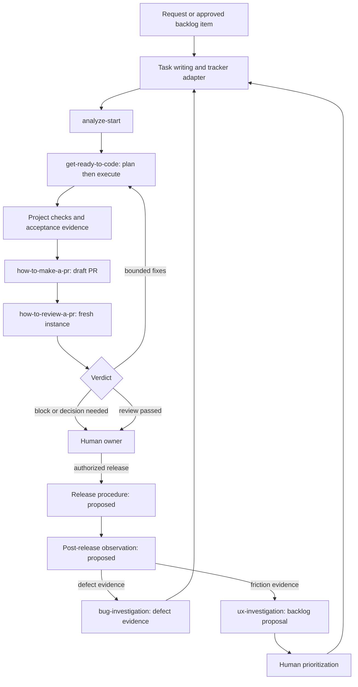

# Seif's skills in the software factory

Discussion design, 30 September 2026. This describes existing instructions and proposed connections; it does not claim a working factory has been demonstrated.

## Authorship and source

Seif states that all skills in the supplied collection are his own work, with AI assistance in writing and committing some of them. We record that authorship here. Git commit author names are contribution metadata, not a determination of who designed the skills. This mapping preserves the source history and does not rewrite attribution.

Source: private [Repaircheck/claude-routines](https://github.com/Repaircheck/claude-routines/tree/449e1110104b6ac27aed3a940c5ed6d1bf671f11/.claude/skills), snapshot `449e1110104b6ac27aed3a940c5ed6d1bf671f11`. The local clone contains 38 skill entrypoints and 61 supporting files. The delivery core and review synthesis were read in detail; the complete inventory was classified using entrypoints and descriptions. Domain routines have not each undergone a full operational audit. None were invoked or imported into this repository for this map.

## What the collection already gives us

The core is a deliberate delivery method: understand the real system, plan before editing, build with local review, and challenge the result against quality, previous behavior, and the original request. The surrounding skills add intake, ticket handling, investigation, integrations, and business workflows.

The lifecycle spans idea, requirements, design, implementation, verification, delivery, and operation. Some skills cross several stages. A skill is a procedure an agent can follow; it is not automatically a running service, connected tool, scheduler, or proof that the procedure succeeds.

```text
SIGNALS              DELIVERY                                            OPERATION
User request         Understand -> Plan -> Build -> Checks -> Draft PR    Release -> Observe
Bug evidence    --->                                           |         ^           |
UX proposal          <---- bounded fixes <---- Review <---------+         |           |
                                                           Human decision            |
      ^______________________________________________________________________________|
      New defects return to intake; UX suggestions enter backlog for prioritization.
```

## Lifecycle and handoffs

| Stage | Existing skills | Required handoff | What remains to connect |
|---|---|---|---|
| Intake and requirements | `how-to-write-a-clickup-task`, `clickup-task`; `bug-investigation` and `ux-investigation` supply signals | Deduplicated work item, intended outcome, evidence, acceptance criteria | Durable claim/ownership, routing, priority and permission profile |
| Understand and design | `analyze-start` | Code-grounded analysis: purpose, callers, contracts, unknowns and user journey | Persist analysis against the work item and starting revision |
| Plan and implement | `get-ready-to-code` | Critiqued file set, phases, todos, plan, changed code | Explicit plan acceptance rule and durable execution state |
| Verify | Build/test gates in PR and review procedures; `deep-review`, `change-guard`, `compliance-check` | Checks and findings tied to the exact reviewed revision | Portable check runner, acceptance scenarios and evidence contract |
| Package delivery | `how-to-make-a-pr` | Draft PR, linked work item and change summary | Project-specific branch, owner, tracker and communication configuration |
| Independent review | `how-to-review-a-pr`, its five review lenses and synthesis | Verdict, applied fixes, remaining flags/blockers, verification | Reliable fresh reviewer dispatch; meaningful diagnosed corrections and fresh acceptance |
| Release | Existing source stops at a draft PR and human handoff | Approved revision, deployment result, recovery path | Reusable release procedure with project-defined authority, staging/smoke and rollback |
| Operate and learn | `bug-investigation`, `ux-investigation` give evidence-based investigations | Incident or improvement proposal with evidence | General post-release checks, monitoring trigger and feedback routing |

`communication-style-in-development` governs summaries and handoffs across stages. `seo-content-redaktion` is a specialist route for relevant content work. Neither needs to run on every code change.

`get-ready-to-code` already includes implementation after its planning phase. We should preserve that capability before inventing a redundant coding skill. Its description says planning-only while its body also executes; the portable version should distinguish the two phases and their transition clearly.



The chart proposes connections, not an already implemented trigger chain. UX proposals remain backlog items until selected. A failed build/check can return to the builder through a diagnosed correction or become a blocker for an actual unresolved dependency. Release requires the applicable project authorization.

## The review station

The original `how-to-review-a-pr` is a self-review procedure for our own draft PR, executed in a separate agent instance. It can make scoped fixes. It is not simply an incoming-PR review tool, and its reviewer is not a fully independent external acceptance authority.

```text
Original request + analysis + current PR diff
                       |
                 Fresh reviewer
                       |
       +---------------+----------------+
       |               |                |
  deep-review     change-guard     compliance-check
  3 distinct      Previous        Original request,
  lenses:         behavior,       agreed plan and
  security        callers,        project rules
  performance     contracts
  user journey    and regressions
       |               |                |
       +---------------+----------------+
                       |
        Dedupe findings -> scoped fixes or flags
                       |
          Re-run relevant checks at new revision
                       |
       Verdict + evidence + human decision handoff
```

These three checks answer different questions:

- `deep-review`: is the implementation sound, secure, usable and efficient?
- `change-guard`: did it break existing behavior or contracts?
- `compliance-check`: did it deliver the thing we actually requested?

The three deep-review passes use different lenses, not three identical scans. The synthesis preserves necessary complexity and flags changes that exceed the original scope. A passing reviewer verdict is not deployment approval. The original request and acceptance criteria must survive handoffs; a builder's persuasive summary is insufficient evidence.

The current reviewer also repeats analysis, considers three solution options, plans and executes before the review battery. When adapting it, decide whether every PR needs that full sequence or whether a sound implementation can proceed directly to checks after analysis. Replanning should address an evidenced defect, not force a redesign merely because a fresh reviewer is present. This is a proposed refinement; the source procedure has not been changed.

## All 38 skills: a useful partition

These are discussion categories, not quality scores or maturity percentages. Each skill appears once in this inventory even when it supports several lifecycle stages. The lifecycle table above shows those overlaps.

| Group | Count | Skills |
|---|---:|---|
| Delivery core | 9 | `analyze-start`, `get-ready-to-code`, `deep-review`, `change-guard`, `compliance-check`, `how-to-make-a-pr`, `how-to-review-a-pr`, `how-to-write-a-clickup-task`, `clickup-task` |
| Investigation, communication and content specialists | 4 | `bug-investigation`, `ux-investigation`, `communication-style-in-development`, `seo-content-redaktion` |
| System adapters | 6 | `superchat-api`, `repaircheck-api`, `autoixpert-api`, `autoixpert-computer-use`, `dat-api`, `notion-api` |
| Business/domain workflows | 19 | `anwalt-versand-abgleich`, `auftragsboerse-monitor`, `autoixpert-gutachten-aufgaben-abgleich`, `autoixpert-payment-reminders`, `dat-kalkulation-v2`, `dat-kalkulation-v3`, `dat-sv-abgleich`, `dispatch-appraiser`, `dokument-generisch`, `dokument-unfallbericht`, `dokument-versicherungsschreiben`, `gutachten-aufbereitung`, `legal-check`, `marktwertanalyse`, `post-submission-eval`, `pre-appraisal`, `repaircheck-briefpapier`, `repairshop-outreach`, `superchat-reply` |

`clickup-task` is an adapter counted in the delivery core because it owns that core's work-item updates. The other adapters supply system knowledge/access procedures where needed. Existing instructions may assume credentials or a proxy; actual access still needs provisioning and verification.

Business workflows are a separate product capability: the factory can build and maintain them, and agents may operate them when specifically authorized. For example, appraisal, document, dispatch and payment workflows do not become mandatory code-delivery stages. Routine findings may create feature or defect requests that enter the delivery pipeline.

## Proposed factory architecture

```text
                    Work item + acceptance criteria
                                |
                FACTORY CONTROLLER (to be built)
          route / claim / hand off / record / retry / stop
                                |
         +----------------------+----------------------+
         |                      |                      |
    DELIVERY SKILLS       SPECIALIST SKILLS       PROJECT PROFILE
    analyze, plan,        bugs, UX, content,      repo, stack, branches,
    build, review, PR     domain workflows       checks, tools, gates
         |                      |                      |
         +----------------------+----------------------+
                                |
                  AGENT HOST + CONNECTED TOOLS
            git / CI / tracker / browser / service APIs
                                |
               Durable state + revision-bound evidence
                                |
               Human decisions at configured boundaries
```

Skills supply procedures. The controller supplies continuity and routing. Tools supply actual capabilities. A project profile supplies the context needed to reuse the procedures beyond RepairCheck. The [Safe Engine design decisions](safe-engine-decisions.md) record the selected direction: a small controller with an entry skill, saved checkpoints, shared gates, and project discovery with review and correction. These components remain unimplemented.

### Minimum shared handoff

For each work item, retain: identifier, repository/base revision, requested outcome, acceptance criteria, allowed scope, relevant project profile, dependencies, authority boundaries, completion boundary, diagnostic history and current owner/state.

For each stage result, retain: work/run identifier, stage, revision, artifact links, checks performed and their results, findings, unresolved questions, next owner and status. Credentials stay outside these records. Evidence of a prior revision must not silently validate new code.

```text
BACKLOG -> READY -> BUILDING -> CHECKING -> IN_REVIEW -> AWAITING_HUMAN
                                                               |
                                                        release authorized
                                                               v
                                                          RELEASING
                                                               |
                                                         smoke checks pass
                                                               v
                                                             DONE

Any active stage -> BLOCKED when an actual dependency, owner-reserved decision or explicit owner stop prevents progress.
Checks/review -> BUILDING for bounded fixes; a new revision invalidates affected checks.
Release failure -> recovery + BLOCKED, with an accurate report.
```

This is a proposed generic state model, not a replacement for ClickUp's existing statuses. A project profile translates it to the actual tracker. In the source, "Development done" means a review handoff; it is not proof of a release or a completed user outcome. A task ends at its defined acceptance boundary; for deployable changes, that includes the agreed release checks.

## What to adapt and what to add

First adapt the nine core skills, preserving their intent and resources. Extract RepairCheck-specific repository names, branches, named reviewers, tracker locations, Slack channels, stack commands and authentication assumptions into project context. Their original operational permissions do not automatically apply to other projects.

Candidate additions below are design proposals only; no placeholder skills have been created:

| Candidate | Purpose | Completion evidence |
|---|---|---|
| `project-context` | Resolve the target repo, checks, integrations and decision boundaries; could be a shared reference/profile rather than a standalone skill | Validated profile and explicit missing dependencies |
| `factory-run` | Route and claim one work item, orchestrate stages, persist handoffs, avoid duplicates, continue meaningful progress and respect actual authority/owner stops | Complete run record or actionable blocker |
| `verify-change` | Run relevant deterministic checks and acceptance scenarios; unify repeated verification requirements | Results and artifacts bound to the exact revision |
| `release-change` | Apply the project's authorized release path, smoke checks and recovery plan | Deployment/version evidence and smoke results, or recovery/blocker |
| `observe-release` | Inspect agreed health/user-outcome signals and route evidenced defects or proposals | Observation result or deduplicated work item |

Seif superseded the initial shared-budget/retry-once proposal on 2 October. Build and review continue through meaningful diagnosed corrections until verified completion. Reassess stalled hypotheses and reconcile uncertain effects; do not reroll an unchanged rejected candidate. Actual missing access/authority or an owner stop blocks dependent work without lowering acceptance.

Preserve the source's quality-first intent, but do not turn "as close to O(1) as possible" into a universal pass criterion. Some valid problems require traversing input. Define the relevant performance requirement and check it for the target workload.

For stronger acceptance later, keep suitable scenarios and expected results outside the builder's unrestricted control. Model review complements executable checks; neither alone proves all business outcomes. Do not infer full autonomy from the number of skill files.

## First end-to-end demonstration

Use one target repository and a small, real task with clear acceptance criteria. Begin with a manually invoked run and an authorized draft-PR boundary. Exercise intake -> analysis -> plan/build -> checks -> fresh review -> human handoff. Demonstrate that an unmet requirement and a regression are detected, and that a failed check leads to correction or a truthful blocker. Preserve the same original task through every handoff.

Record outcome, correction cycles, elapsed time, model/tool cost where available, human intervention and evidence completeness. Avoid importing all domain routines before the delivery loop is proven. Add release/observation when the selected project's access and authorization support them.

This gives us a reusable factory backbone built from Seif's existing work, then a deliberate path toward unattended operation.
