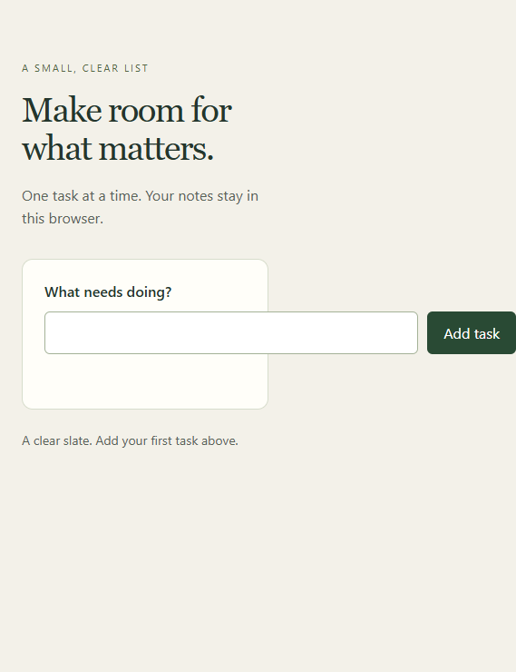
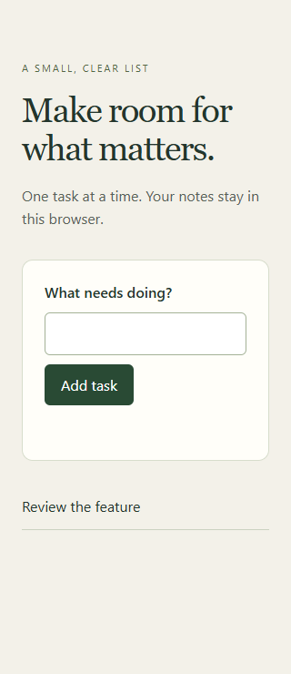
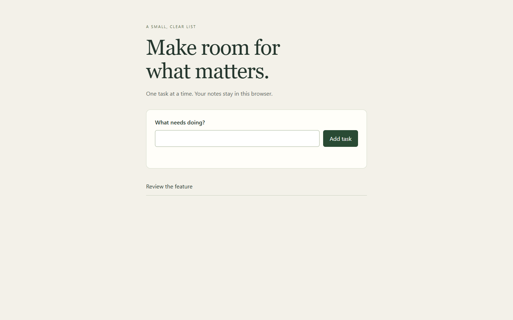

# The first example, step by step

This is a **recorded walkthrough of 1 October 2026**, using Safe Engine at factory commit `eeb0da9`. It is not a new run, a video recording, or proof that every kind of app works. The assistant chose this small fixture for the authorized disposable demonstration; Seif did not choose the task-notes product. The next example will use Seif's brief.

## 1. The job

Make a task-notes app usable on a narrow phone. Keep Add task on screen, reject whitespace-only titles with useful feedback, and preserve keyboard submission and saved tasks after reload. Keep the existing visual direction.

Three requirements were fixed before implementation:

| Requirement | What acceptance exercised |
|---|---|
| A1 | At 320px, no horizontal page scroll and the Add task button fits. |
| A2 | Spaces alone add nothing and show feedback; valid titles are trimmed. |
| A3 | Enter submits a valid task, confirmation appears, and reload restores it; desktop remains usable. |

## 2. Before the repair

The baseline browser assertion failed: `Mobile page overflows horizontally`. The unit assertion failed: `Whitespace-only titles must be rejected`, with actual `'   '` instead of `''`.



The browser captured the overflowing full page, so the image is wider than its 320px viewport. The form's fixed row extends beyond its parent and the phone screen. This is the actual before image, not a design mockup.

## 3. Analyze and plan before coding

The analysis read the markup, stylesheet, submit handler, model and acceptance scripts. It mapped the actual consumers:

```text
index.html -> style.css -> .entry layout [fixed 520px width]
     |
     +-> app.js -> readTasks -> localStorage -> render

click / Enter -> submit -> normalizeTitle [returned raw input]
                             |
                    empty? --+-- yes -> feedback; no write
                             |
                             no -> save -> render -> confirmation
```

The plan selected **two files**: `model.mjs` and `style.css`. Its critique rejected extra changes to markup or the submit handler: labels, native submission, feedback and an empty-title branch already existed. The five planning outputs covered the file list, critique, phases, todos and complete plan. The history records analysis and planning before the code batch.

## 4. The actual implementation

Each change used the 0–4 loop: prepare context, inspect the change site, apply, inspect the result, correct if needed. No tests ran between these two edits.

```diff
--- model.mjs
 export function normalizeTitle(value) {
-  return value;
+  return value.trim();
 }

--- style.css
-.entry{display:flex;gap:10px;width:520px}
+.entry{display:flex;flex-wrap:wrap;gap:10px}
-input{flex:1;padding:12px;border:1px solid #a4b297;border-radius:6px;font:inherit}
+input{flex:1 1 220px;min-width:0;padding:12px;border:1px solid #a4b297;border-radius:6px;font:inherit}
```

Trimming reuses the existing empty-title branch. Flexible wrapping makes the row fit without duplicated mobile markup. The acceptance files were unchanged.

## 5. Batch checks and improvement

Both real commands then passed:

```text
node tests/unit.mjs
PASS: title validation and existing storage behavior

node tests/browser.cjs
PASS: mobile layout, blank-title rejection, keyboard submission,
feedback, reload persistence, desktop, no page errors
```

The improvement pass inspected cleanup, reuse, design, performance, security and agent navigability. It found no worthwhile extra refactor. Titles still render through `textContent`; the model owns normalization and CSS owns layout. No performance gain was claimed. The pilot reran its final batch; skipping unchanged checks safely remains a speed improvement to make.

## 6. After the repair



The action now fits beneath the input on mobile. The recorded task is visible after reload. Desktop retains the horizontal form:



These are unmodified screenshots from the accepted first run. They document history; they are not reusable passing evidence for another candidate.

## 7. Fresh review and handoff

A separate read-only Codex process inspected the source, actual checks, logs, screenshots and method artifacts. It returned **PASS for A1, A2 and A3**, `method_followed: true`, and an empty findings list. The controller then produced the local handoff. No application push or deployment occurred.

Selected stage times on 1 October, in Africa/Tunis:

| Time | Recorded transition |
|---|---|
| 20:30:27 | Initialized the accepted task and profile |
| 20:30:41 / 20:30:43 | Recorded analysis / plan |
| 20:31:11 | Recorded the completed code batch |
| 20:31:15 | First QA batch passed |
| 20:31:52 / 20:31:55 | Recorded improvement / final QA passed |
| 20:34:28 | Fresh review passed |
| 20:35:09 | Checked local handoff created |

Those timestamps describe the controlled run, not all preparation time or a real-feature speed benchmark. The broader controller had 18 passing tests. Review responses in those unit tests were test doubles; the review above was an actual independent process.

## Inspect the original evidence or open the app

On the original computer, preserved evidence is under `C:/work/safe-engine-pilot-20261001/app/.factory/`: `artifacts/0002-analysis.md`, `0003-plan.md`, `0004-batch.md`, `0007-improvement.md`, `logs/0008-unit.log`, `logs/0008-browser.log`, `review-0010.json` and `handoff.md`. The app's two-file diff remains in its disposable worktree. These paths are local; they are not downloadable from another machine.

From the factory root, show the preserved repaired app:

```powershell
py -3 examples/serve-pilot.py --project 'C:\work\safe-engine-pilot-20261001\app' --port 8770
```

Open `http://127.0.0.1:8770/`. Try spaces, then a valid task, Enter and reload. This is an interactive inspection of the preserved app, not a rerun of its historical QA or independent review. The server only exposes the public fixture files. Stop it with Ctrl+C when finished.

Factory instructions have evolved since this acceptance. The controller may correctly report the old run's evidence stale against an updated bundle; the dated record remains evidence of what passed then. [Complete reproduction commands](pilot-commands.md), [first-run verification](../docs/pilot-verification.md), and [fresh-session starter](../docs/start-another-session.md).
